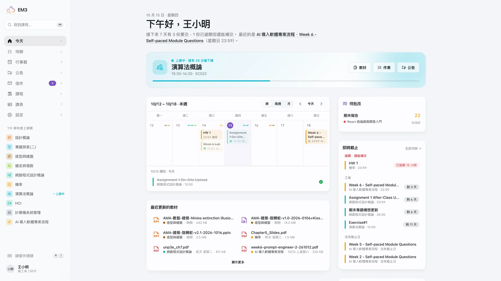
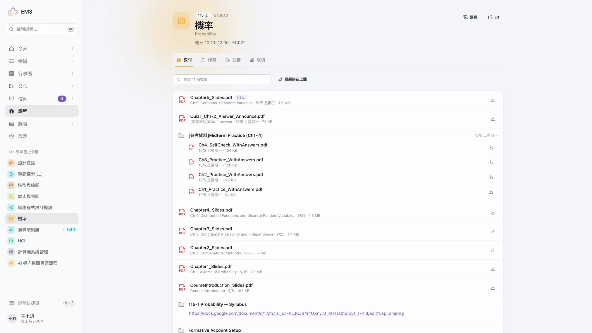
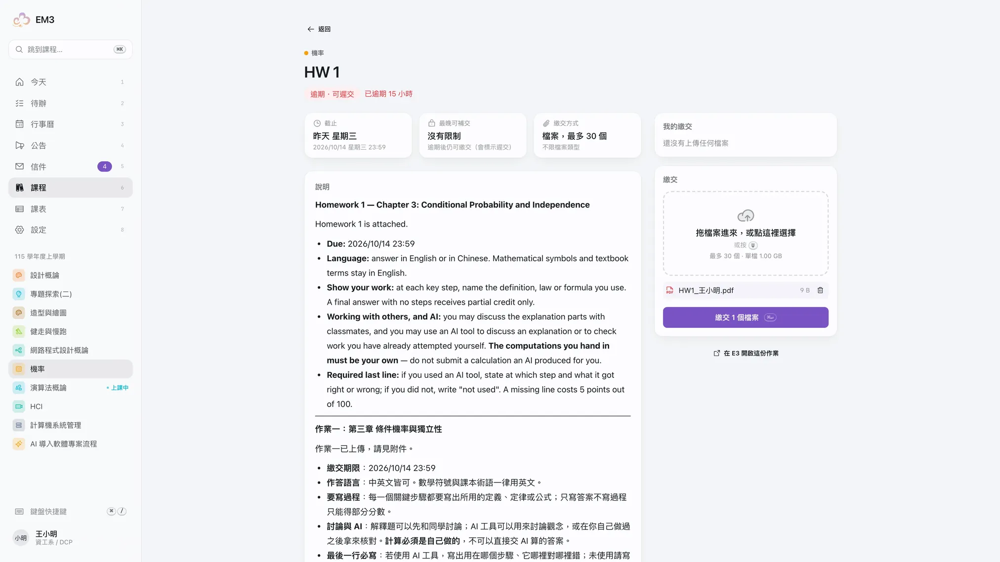
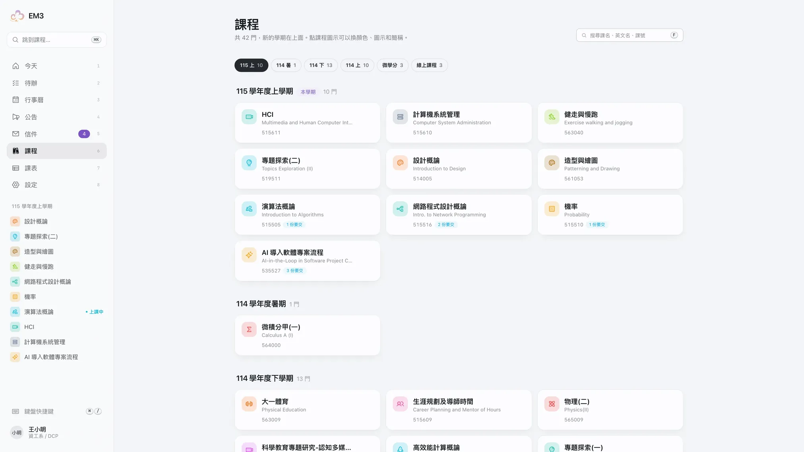
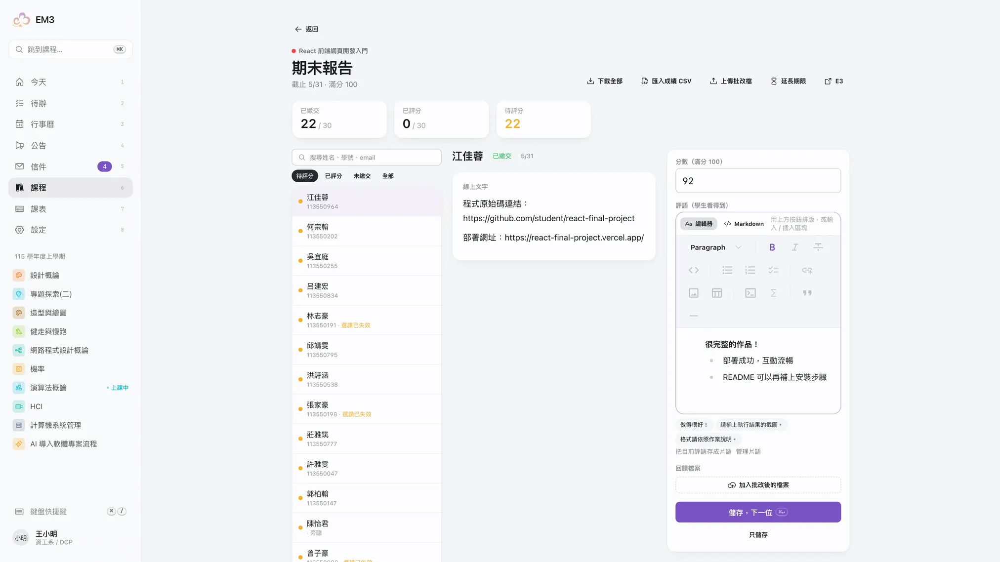
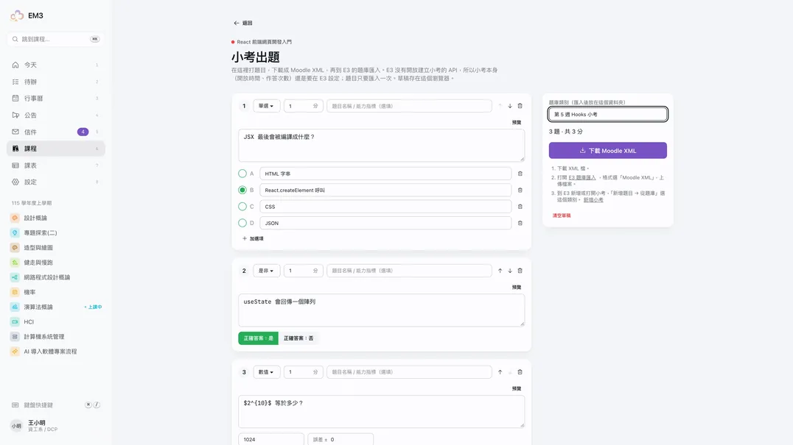
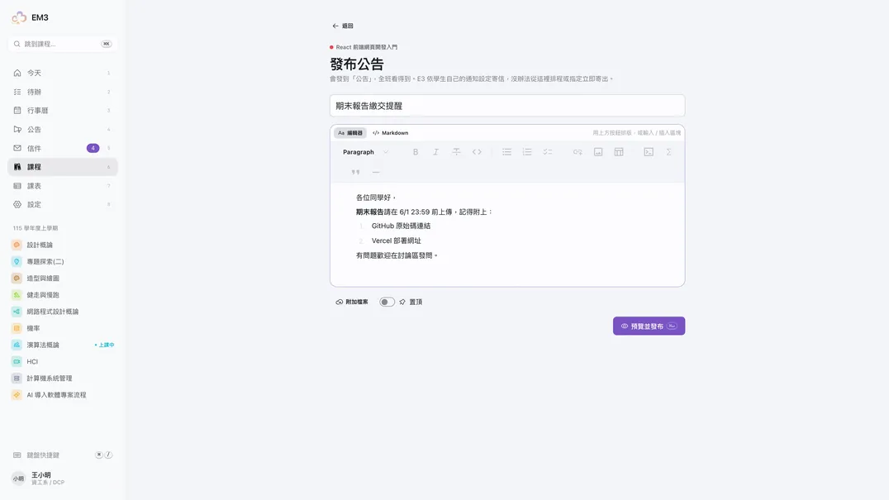
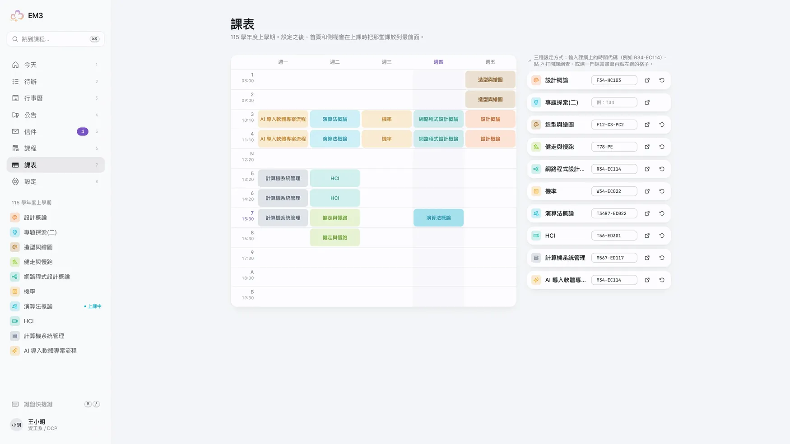
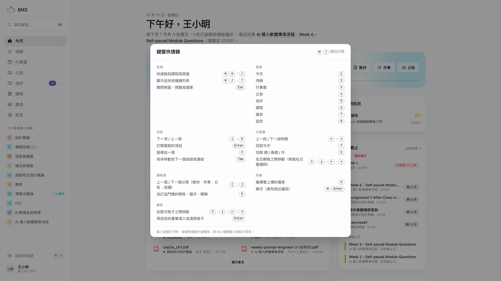
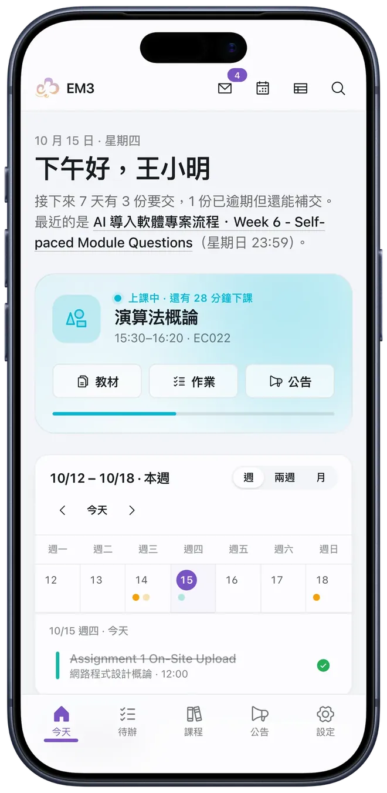

<div align="center">


# EM3

**E3 拉完了，寫個給人用的吧。**

給人用的 E3 客戶端，學生、老師、助教都能用：這週要交什麼、這堂課的教材、三步交作業、J/K 改作業，一打開就看得到。

[**打開 e3.emtech.cc**](https://e3.emtech.cc) · [在 GitHub 上給顆星 ⭐](https://github.com/elvisdragonmao/EM3)

[](https://github.com/elvisdragonmao/EM3/stargazers)

</div>

<picture>
  <source media="(prefers-color-scheme: dark)" srcset="public/screens/dashboard-dark.webp">
  
</picture>

## 為什麼要做這個

E3 打開毫無重點，什麼都找不到。新生分不清「總覽、公告、大綱、教材」差在哪；首頁要往下捲整個畫面才看得到沒有課名的「未來事件」；午夜截止的作業顯示成隔天的「AM 12:00」；交一份作業要經過維基圖庫和八種授權條款。老師那邊也沒好到哪去：評分表一列都塞不下，下載的作業對不回學號，出一份小考要填 136 個欄位。

## 有什麼不一樣

### 打開就知道今天要做什麼

首頁第一個畫面就是這週：每份作業都標出是哪門課、交了沒、還剩多久。設定課表之後，正在上的那堂課會放在最上面，附上下課倒數，以及教材、作業、公告的捷徑。

### 時間用講的

| E3 上的寫法                  | EM3                  |
| ---------------------------- | -------------------- |
| `10月 22日 星期四, AM 12:00` | 下星期三 10/21 24:00 |
| `10月 21日 星期三, PM 11:59` | 下星期三 10/21 23:59 |
| `10月 14日`                  | 昨天 星期三          |
| `10 10月 2026`               | 10/10 上星期六       |

### 一個檔案，就是一個檔案

E3 的「教材」其實是資料夾，而大部分資料夾裡只有一份投影片。EM3 把它們攤平，最新的放最上面，一週內的新檔案會標出來。PDF、圖片、影片直接在旁邊預覽。

<picture>
  <source media="(prefers-color-scheme: dark)" srcset="public/screens/materials-dark.webp">
  
</picture>

### 上傳檔案，交出去，很難嗎？

允許的檔案類型寫在拖放區裡，選錯當場提醒。按下繳交前會列出 E3 上最後會有哪些檔案，逾期也會先告訴你。

<picture>
  <source media="(prefers-color-scheme: dark)" srcset="public/screens/submit-dark.webp">
  
</picture>

### 學期過了，課程就不見了是三小

所有學期一頁列完，本學期在最上面，微學分和線上課程分開放。每門課有自己的顏色和圖示，可以取簡稱、置頂或隱藏。

<picture>
  <source media="(prefers-color-scheme: dark)" srcset="public/screens/courses-dark.webp">
  
</picture>

### 給老師和助教

在 E3 當老師或助教的課，課程頁會多一個「教學」分頁，首頁也會出現「待批改」。

- **評分工作台**：左邊名單（含學號），右邊作業內容；打分數、寫評語，`⌘↵` 存檔跳下一位，`J` / `K` 換人。評語可以用按鈕排版或寫 Markdown，常用句子存成片語。選課已失效但有交的學生也會列出來，E3 自己的評分表會漏掉他們。
- **下載 → 離線批改 → 送回**：zip 依「學號_姓名」分資料夾並附成績表；改好的檔案拖回來自動對回學生，成績用 CSV 匯入（UTF-8 或 Big5 都可以），寫入前先看新舊對照。
- **延長期限、複製未繳名單**：一鍵 +1、+3、+7 天，名單直接貼到 LINE。
- **發公告**：Milkdown 編輯器，有按鈕列，也能寫 Markdown；發布前先預覽學生看到的樣子。
- **小考出題**：打題目或從 Excel 貼上，匯出 Moodle XML 到 E3 題庫匯入。
- **寫教材**：E3 沒開放新增教材的 API，所以在 EM3 寫好、一鍵複製貼回 E3。
- **助教分工**（伺服器版）：依學號把學生分給各個助教，評分時「只看我這組」；名單上看得到誰正在改哪位學生，存檔前也會再讀一次 E3 上的成績，不會互相覆蓋。
- **排程公布**（伺服器版）：分數先存在 EM3，到了指定時間一次寫進 E3，全班同時收到通知。

<picture>
  <source media="(prefers-color-scheme: dark)" srcset="public/screens/grading-dark.webp">
  
</picture>

<table>
  <tr>
    <td width="50%">
      <picture>
        <source media="(prefers-color-scheme: dark)" srcset="public/screens/quiz-dark.webp">
        
      </picture>
    </td>
    <td width="50%">
      <picture>
        <source media="(prefers-color-scheme: dark)" srcset="public/screens/announce-dark.webp">
        
      </picture>
    </td>
  </tr>
</table>

### 課表、信件、鍵盤、手機、主題、語言

- **測驗**：直接在 EM3 作答，自動儲存、倒數計時、交卷前列出還沒作答的題目。用了 Safe Exam Browser 這類限制的測驗才需要到 E3。
- **課表**：貼上課綱上的時間代碼（例如 `T34R7-EC022`），或直接在格子上點。中正的上課時間會從 Moodle 自動帶入；伺服器版的陽明交大課表也會從課綱自動帶入。
- **提醒**（伺服器版）：作業快截止、有作業要評分時，用瀏覽器推播或 Discord Webhook 通知你，沒開 EM3 也收得到。
- **跨裝置同步**（伺服器版）：課程顏色、課表、片語等設定在每台裝置都一樣。
- **信件**：站內信直接在 EM3 讀，可以依課程分類、搜尋、標回未讀（目前支援陽明交大與中正）。Moodle 沒開放寄信的 API，所以回信會打開學校網站。
- **鍵盤**：`⌘K` 跳到任何一門課，`1`–`8` 切換頁面，`J` / `K` 上下移動，`⌘/` 列出全部快捷鍵。
- **手機**：底部導覽列、精簡週曆，PDF 交給手機自己的檢視器開。
- **主題**：daisyUI 的全部主題，加上 EM3 自己的淺色和深色。設定可以匯出成 JSON 帶到別台電腦。
- **語言**：繁體中文、English、日本語，還有只用 Emoji 的版本。預設跟隨系統語言，可以在設定裡改。
- **無障礙**：以 WCAG 2.1 AA 與臺灣網站無障礙規範 AA 等級為目標，檢測方式與逐項自評見 [DESIGN.md 的無障礙](DESIGN.md#無障礙)。

<table>
  <tr>
    <td width="66%">
      <picture>
        <source media="(prefers-color-scheme: dark)" srcset="public/screens/timetable-dark.webp">
        
      </picture>
      <picture>
        <source media="(prefers-color-scheme: dark)" srcset="public/screens/shortcuts-dark.webp">
        
      </picture>
    </td>
    <td width="34%">
      <picture>
        <source media="(prefers-color-scheme: dark)" srcset="public/screens/mobile-dashboard-dark.webp">
        
      </picture>
    </td>
  </tr>
</table>

## 使用

打開 [e3.emtech.cc](https://e3.emtech.cc)，選擇學校後用原本的 Moodle 帳號和密碼登入（中正使用學校單一登入），不用安裝任何東西。登入頁已內建陽明交大、中正、臺師大、政大、成大、銘傳、暨南、高雄大學與臺南大學，也可以貼上其他學校的 Moodle 首頁或登入頁網址。

其他學校必須啟用 Moodle 行動版 Web Service，並允許瀏覽器跨網域呼叫 API；若學校未開放，EM3 會在登入時說明。課程、作業、公告、教材等標準 Moodle 功能可跨校使用；課表的節次時間目前有陽明交大與中正，站內信支援陽明交大與中正，交大課綱連結只適用陽明交大。

第一次登入後會問你要用哪個版本，之後可以在「設定 → 版本」改：

- **伺服器版（推薦）**：多了截止提醒、跨裝置同步、陽明交大課表自動帶入和助教協作。Moodle 登入憑證會加密保存在 EM3 伺服器，讓它在你沒開 EM3 時也能檢查截止時間。
- **本機版**：所有資料只留在這個瀏覽器，完全不連 EM3 伺服器。

想要像 App 一樣從主畫面打開，可以把它裝起來：iPhone 用 Safari 的「分享 → 加入主畫面」，Chrome 和 Edge 點網址列的安裝按鈕，或到 EM3 的「設定 → App」。裝好後會在自己的視窗打開，沒有網路時也看得到上次載入的內容。

如果 EM3 讓你少遲交了一次作業，請到 [GitHub](https://github.com/elvisdragonmao/EM3) 按一顆 ⭐，讓更多同學找到它。發現問題或有想要的功能，歡迎開 [issue](https://github.com/elvisdragonmao/EM3/issues)。

## 隱私

- **你選資料放哪裡。** 瀏覽器一律直接呼叫你所選學校的 Moodle 行動版 API。本機版不連 EM3 伺服器；伺服器版把 Moodle 登入憑證用 AES-256-GCM 加密存在 EM3 伺服器（Cloudflare D1），用來提醒、同步和助教協作。切回本機版就會刪掉伺服器上你的所有資料。
- **不存密碼。** 密碼只會送到學校的 Moodle，用來換一組登入憑證，憑證與 Moodle 網址放在這個網站的 cookie，登出就清掉。單一登入時，Moodle 直接把憑證交回 EM3，EM3 會核對它是這次登入產生的，用過就丟掉。
- **不替你按已讀。** 公告的已讀狀態只記在你的瀏覽器（站內信例外：打開時會像在學校網站一樣標為已讀）；EM3 在你按下「確定繳交」之前不會動你的作業，老師的評分也要按下儲存才會寫入。
- 個人設定存在 `localStorage`（伺服器版另外同步一份到伺服器），E3 資料的快取存在 IndexedDB，登出時一併清除。

README 和首頁的截圖使用測試帳號拍攝，姓名、學號、作者都在拍攝時換成假資料（見 `scripts/capture-screens.mjs`）。

## 開發

需要 Node.js 24 以上與 pnpm。

```sh
pnpm install
pnpm dev          # http://localhost:5173
pnpm dev:server   # 伺服器版的 Worker 與本機 D1（http://localhost:8787，/api 由 Vite 代理過去）
pnpm build        # 型別檢查並輸出到 dist/
pnpm format       # Prettier
pnpm run deploy   # 部署到 Cloudflare（需要 wrangler 登入）
```

技術：React 19、Vite、TypeScript、Tailwind CSS 4、daisyUI 5、TanStack Query、TanStack Router（hash history）、Zustand、motion、Phosphor Icons；伺服器版用 Cloudflare Workers、D1 與 Cron Triggers。

支援的 Moodle 站台會讓 `login/token.php`、`webservice/rest/server.php`、`webservice/upload.php`、`webservice/pluginfile.php` 回應 `Access-Control-Allow-Origin: *`，所以本機版的 `dist/` 可以放在任何靜態主機上，不需要 proxy。伺服器版的 Worker 在 `worker/`，開發方式見 `AGENTS.md`，設計見 [DESIGN.md](DESIGN.md#伺服器版)。

### 專案結構

功能導向，每個 feature 自己擁有頁面、元件與資料存取：

```
src/
  app/             路由、App 外殼、Query client、主題同步
  lib/moodle/      Moodle Web Service client、站台清單、型別、檔案 URL 與 HTML 處理
  lib/time/        相對時間與截止時間的寫法（四種語言）
  i18n/            語言偵測、defineMessages、共用字詞
  shared/          共用 UI、Milkdown 編輯器、鍵盤快捷鍵、hooks
  features/
    landing/       未登入時的介紹頁
    auth/          登入、token cookie
    dashboard/     今天
    assignments/   待辦、作業頁、繳交
    announcements/ 公告收件匣、單篇公告
    calendar/      行事曆
    courses/       課程列表、課名解析、顏色與圖示
    course/        課程頁（教材、作業、公告、成績）、檔案預覽
    timetable/     課表與節次
    mail/          站內信
    teaching/      教學分頁、評分工作台、批次工具、公告、小考出題、寫教材
    preferences/   localStorage 設定
    settings/      設定頁、主題清單
worker/            伺服器版：Cloudflare Worker 的 /api（帳號、同步、提醒、助教協作）
migrations/        伺服器版的 D1 資料表
scripts/           給開發與 agent 用的唯讀 E3 工具、截圖腳本
```

### 更新截圖

```sh
pnpm dev
NODE_PATH=$(npm root -g) node scripts/capture-screens.mjs /tmp/em3-screens
python3 scripts/screens-to-webp.py /tmp/em3-screens
```

需要 `.env.local` 裡的 `E3_USERNAME` / `E3_PASSWORD`，以及全域安裝的 Playwright。桌機截圖用 1920×1080 的 2 倍拍；手機截圖用 iPhone 17 Pro 的尺寸（402×874 @3x）拍，再合成進 `scripts/assets/iphone17pro.png` 的外框。`scripts/screens-to-webp.py` 會把每張圖縮到它在介紹頁或 README 上最大顯示寬度的 2 倍，存成品質 80 的 WebP。

### 更新圖示與分享圖

```sh
NODE_PATH=$(npm root -g) node scripts/make-brand.mjs
```

從 `src/shared/ui/Logo.tsx` 的 logo 畫出 favicon、App 圖示和 `public/og.jpg`（分享預覽圖，會用到 `public/screens/dashboard-light.webp`）。改了 logo、首頁標題或首頁截圖之後要重跑。

## 授權

[Apache License 2.0](LICENSE)。EM3 是非官方專案，與國立陽明交通大學無關。
